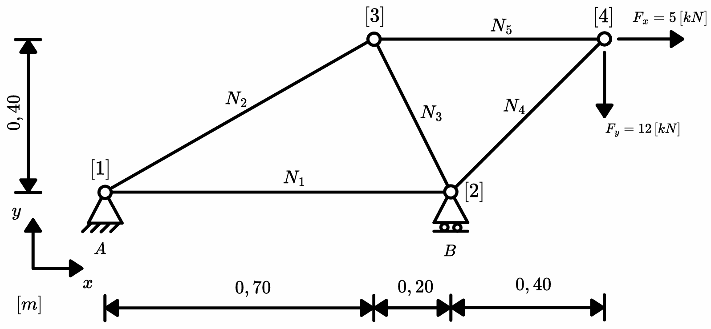

# Description
Lightweight 2D truss solver (linear) using the finite element method.

- no external FE libraries needed
- OS independent
- suitable for mobile use with IOS Pythonista

# Quick Start

````python
from src.truss_fem_2d import *

# CREATE STATIC SYSTEM
SYSTEM = StaticSystem()

# ADD NODES
SYSTEM.add_node(x=0.00, y=0.00, x_dof=DegreeOfFreedom.FIXED, y_dof=DegreeOfFreedom.FIXED)
SYSTEM.add_node(x=0.90, y=0.00, y_dof=DegreeOfFreedom.FIXED)
SYSTEM.add_node(x=0.70, y=0.40)
SYSTEM.add_node(x=1.30, y=0.40, Fx=5, Fy=-12)

# ADD ELEMENTS
SYSTEM.add_element(start_node=1, end_node=2)
SYSTEM.add_element(start_node=1, end_node=3)
SYSTEM.add_element(start_node=3, end_node=2)
SYSTEM.add_element(start_node=2, end_node=4)
SYSTEM.add_element(start_node=3, end_node=4)

# PRINT NORMAL FORCES
RESULTS = LinearTrussSolver(SYSTEM)
RESULTS.print_results()
````

````
--- SUPPORT FORCES ---
Fx1 = -5,00 [kN]
Fy1 = -7,56 [kN]
Fy2 = 19,56 [kN]

--- NORMAL FORCES ---
N1 = -8,22 [kN]
N2 = 15,23 [kN]
N3 = -8,45 [kN]
N4 = -16,97 [kN]
N5 = 17,00 [kN]
````


# Finite Element Method  (linear)
## General description FEM
The Finite Element Method is a numerical calculation method that, among other things, can be used for structural analysis. It is mostly used for systems where analytical solutions are simply not feasible or too complex due to the size of the system, changing cross sections of a beam or other things.  

In general the results of a Finite Element calculation shall be used cautiously.
Keep in mind that:
- FEA is a numerical approximation and no analytical solution
- The FEA is only as good as the mesh refinement (singularities)
- Round-off errors can become an issue for large systems or for systems with strongly varying stiffnesses, since these lead to an ill-conditioned stiffness matrix.

## this solver
Due to the simplicity of this solver, the calculated forces should be reliable in most cases. Nevertheless, the points mentioned above must be taken into account.


## Element Stiffness Matrix
$\alpha \rightarrow$ angle of the element  
$E \rightarrow$ modulus of elasticity  
$A \rightarrow$ area of the cross section  
$L \rightarrow$ length of the element  

$s = \sin(\alpha)$  
$c = \cos(\alpha)$  


```math
K = 
\frac{E \cdot A}{l} \cdot 
\begin{bmatrix}
c^2 & s \cdot c & -c^2 & -s \cdot c\\
s \cdot c & s^2 & -s \cdot c & -s^2\\
-c^2 & -s \cdot c & c^2 & s \cdot c\\
-s \cdot c & -s^2 & s \cdot c & s^2\\
\end{bmatrix}
```


## Assembly of the System Stiffness Matrix
Assuming we want to calculate a static system with `4 nodes` in total and want to add the first element to the system stiffness matrix.
The first element starts at `node 2` and ends at `node 4`.

### global element stiffness matrix
```math
K = 
\frac{E \cdot A}{l} \cdot 
\begin{bmatrix}
c^2 & s \cdot c & -c^2 & -s \cdot c\\
s \cdot c & s^2 & -s \cdot c & -s^2\\
-c^2 & -s \cdot c & c^2 & s \cdot c\\
-s \cdot c & -s^2 & s \cdot c & s^2\\
\end{bmatrix}
=
\begin{bmatrix}
k_{11} & k_{12} & k_{13} & k_{14}\\
k_{21} & k_{22} & k_{23} & k_{24}\\
k_{31} & k_{32} & k_{33} & k_{34}\\
k_{41} & k_{42} & k_{43} & k_{44}\\
\end{bmatrix}
```

The location (row and column in the system stiffness matrix) of each value of the element stiffness matrix is **only** dependent on degrees of freedom of the start- and end node of that specific element.  

$u_i \rightarrow$ horizontal displacement for node $i$  
$v_i \rightarrow$ vertical displacement for node $i$  

||$u_2$|$v_2$|$u_4$|$v_4$|
|:-:|:-:|:-:|:-:|:-:|
|$F_{x,2}$|$k_{11}$|$k_{12}$|$k_{13}$|$k_{14}$|
|$F_{y,2}$|$k_{21}$|$k_{22}$|$k_{23}$|$k_{24}$|
|$F_{x,4}$|$k_{31}$|$k_{32}$|$k_{33}$|$k_{34}$|
|$F_{y,4}$|$k_{41}$|$k_{42}$|$k_{43}$|$k_{44}$|

### system stiffness matrix
- the matrix will always have a shape of $n \times n$
    - in this case $\rightarrow 2 \,\left[\frac{DOF}{node}\right]$ 
    - $\rightarrow n_{rows} = n_{cols} = n_{nodes} \cdot 2$
- The empty system stiffness matrix contains only zeros.
- Each value of all global element stiffness matrices shall be added to  the existing value with matching indices.

||$u_1$|$v_1$|$u_2$|$v_2$|$u_3$|$v_3$|$u_4$|$v_4$|
|:-:|:-:|:-:|:-:|:-:|:-:|:-:|:-:|:-:|
|$F_{x,1}$|$0$|$0$|$0$|$0$|$0$|$0$|$0$|$0$|
|$F_{y,1}$|$0$|$0$|$0$|$0$|$0$|$0$|$0$|$0$|
|$F_{x,2}$|$0$|$0$|$0 + k_{11}$|$0 + k_{12}$|$0$|$0$|$0 + k_{13}$|$0 + k_{14}$|
|$F_{y,2}$|$0$|$0$|$0 + k_{21}$|$0 + k_{22}$|$0$|$0$|$0 + k_{23}$|$0 + k_{24}$|
|$F_{x,3}$|$0$|$0$|$0$|$0$|$0$|$0$|$0$|$0$|
|$F_{y,3}$|$0$|$0$|$0$|$0$|$0$|$0$|$0$|$0$|
|$F_{x,4}$|$0$|$0$|$0 + k_{31}$|$0 + k_{32}$|$0$|$0$|$0 + k_{33}$|$0 + k_{34}$|
|$F_{y,4}$|$0$|$0$|$0 + k_{41}$|$0 + k_{42}$|$0$|$0$|$0 + k_{43}$|$0 + k_{44}$|


## Solve System
$K \rightarrow$ System Stiffness Matrix  
$F \rightarrow$ force vector  
$u \rightarrow$ displacements  

$$F = K \cdot u$$
by rearranging the equation to
$$u = F \cdot K^{-1}$$
we can now calculate the displacements of each node in the global coordinate system.

## Support Reactions

A support reaction can be calculated by multiplying the associated row of the system stiffness matrix with the displacements vector.  
### for example
Node 1 of a static system is fixed horizontally and we want to calculate the resulting support force $F_{x,1}$.  
`Fx1 = K[0] @ u`

# Validation (example)
I validated the code by calculating a simple truss example by hand and comparing each result. Click [here](example.ipynb) to go to the example.

# Limitations
The linear system of equations is solved by using `numpy.linalg.solve` which uses a dense LU decomposition (LAPACK). This could result in high memory use for large systems.
- **Memory:** the system stiffness matrix is stored densely and is not suitable for large sparse matrices because all of the zeros will be processed.
    - This could result in a `MemoryError` for systems exceeding ~6000 - 9000 DOF (~3000 - 4500 nodes) if the code is run on Pythonista on an Ipad.
    - For larger models with a sparse system stiffness matrix, switching to `scipy.sparse.linalg.spsolve` is recommended.
- **Unstable structures:** If the system stiffnes matrix is singular or nearly singular a `LinAlgError` is expected.


# License
This project is licensed under the MIT License. See the [LICENSE](LICENSE) file for details.


